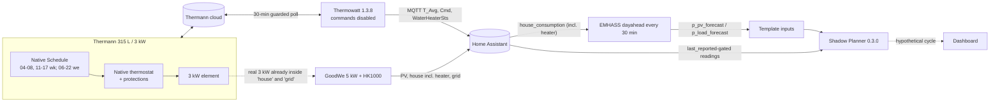
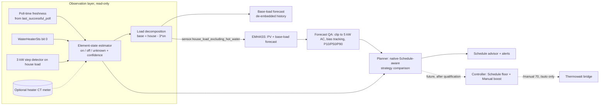

# Thermann smart hot water — independent system audit and redesign (Stage 1)

**Date:** 2026-11-11 (Hobart) · **Auditor:** Claude · **Status:** Stage 1 audit for owner/ChatGPT review.
**No production code, live heater, native Schedule, T-Comfort, Home Assistant or EMHASS setting was changed.
No Thermann command or extra cloud request was made.**

Evidence base: review branch `codex/review-live-config-2026-11-11` @ `51ec4e6`
(`audit/` snapshots), the code on that commit (identical to the installed
Shadow Planner 0.3.0, `bd95f04`), EMHASS v0.18.8 source, and a **local, read-only
copy of the running HA recorder database** (8 Nov 23:02 – 11 Nov 12:22 Hobart).
The database copy stayed in a private scratch folder and is **not** in this
repository; only aggregated numbers are quoted here.

Evidence labels used throughout: **Verified** (directly measured or read),
**Strong evidence** (several independent consistent signals), **Inferred**
(reasonable deduction), **Unverified** (assumption).

> Disclosure: several Phase 2B behaviours criticised below (the
> `WAIT FOR SOLAR` labelling rule, ideal-energy cycle accounting, the
> deadline-follows-peak rule kept from Codex, the force-updated smoke test) were
> written or retained by me in the previous session. They are assessed here with
> the same standard as everything else.

---

## 0. Executive summary

1. **The planner is blind most of the time (Critical).** Its freshness gate uses
   each entity's `last_reported`, but HA's MQTT entities only write state when the
   payload changes. An unchanged Schedule mode/status therefore looks "stale" 45
   minutes after its last *change*. On 11 Nov the planner was blocked for about
   **10 of the 12.3 h** between 00:04 and 12:22, including the **whole 04:01–08:02
   morning heating cycle**. The CI smoke test hid this by writing states with
   `force_update=True`.
2. **The observed `WAIT FOR SOLAR` (11:42) was wrong.** The 3 kW element was
   almost certainly already running under native Schedule, entirely on solar. The
   planner treated the 1.2 kW of export as all the solar available to an
   *additional* 3 kW load. It priced "heat now" at **$1.04** for the remaining
   6.59 kWh when the true incremental cost was **$0.61**: pure foregone feed-in,
   the cheapest possible. The label also contradicted the planner's own rule
   (waiting was "better" by $0.065, below its $0.10 threshold).
3. **The EMHASS household-load forecast is contaminated (Critical).** It is a
   24-hour persistence forecast of `goodwe_inverter_house_consumption`.
   (a) Until the HK1000 meter's communication became *Normal* at **Tue 10 Nov
   14:25**, that sensor was really **PV output** (the meter read 0 W). So the
   11:30 "load" of 4.48 kW was Tuesday's solar production.
   (b) It replays native heater cycles as household demand: the 16:00 forecast
   of 3.87 kW is Tuesday's 15:56–16:46 element run.
4. **Both PV forecasts under-predicted the clear midday** on 11 Nov: EMHASS 3.43–3.50 kW
   and Forecast.Solar ~3.8 kW, against a measured 4.97 kW AC / 5.12 kW DC that was
   **flat for three hours (inverter clipping)**. EMHASS also models each array with
   its own 5 kW inverter, so it never applies the real single 5 kW AC ceiling. The
   planner's measured-PV correction can only lower forecasts, so it could not
   correct a 1.7 kW under-forecast.
5. **`WaterHeaterSts` is very likely an element-energised indicator.** In 5 of 5
   observed transitions, 32→33 followed a measured +3 kW load step within one poll,
   and 33→32 followed the −3 kW step. It stayed 32 inside a Schedule window while
   no step occurred. This is not proof, but it is the best supported heater-state
   signal available. The existing code deliberately ignores it.
6. **The temperature reading is not the thermostat's control temperature.** It is
   the vendor field `T_Avg`.
   - Heating stopped on Tuesday at 16:46 with the reading at 63 °C (target 70).
   - Inside a permitted window it did not heat at 62–64 °C (14:25–15:56), then
     started at 64 °C.
   - After draws the reading collapses (58 → 16 °C overnight) and then jumps
     (37 → 52 °C in ~16 min of heating).
   - Over a full heat-up from cold, though, the uniform-tank model fits well:
     12.1 kWh ⇒ +33 °C, i.e. 0.367 kWh/°C against the assumed 0.3663.
7. **The afternoon deadline uses the 17:00 (daylight-time) tariff peak, not your
   16:00 preference.** This contradicts requirement 2.
8. **Future control:** no independently recoverable On/Off exists. The safest
   viable architecture is **"native Schedule floor + Manual boost"**. Your native
   Schedule is narrowed to guaranteed fallback windows; Home Assistant uses
   `Manual 70 °C` only to *add* heating and returns to `Schedule` to stop. It
   never uses Off. That fails warm (comfort safe) rather than cold, but `/auto`
   and `/manual` must first be qualified under supervision. Until then the right
   next step is a read-only **"Schedule advisor"** that evaluates, and recommends
   changes to, what the native Schedule actually does.

The current planner's arithmetic for partial solar is correct in isolation
(2 kW solar + 1 kW off-peak import for 1 h = $0.3557). The problems are what is
fed into it, what it assumes is happening physically, and how it is gated.

---

## 1. Findings register

| ID | Sev. | Finding | Evidence | Source |
|---|---|---|---|---|
| F1 | **Critical** | Freshness gate uses `state.last_reported`. HA MQTT entities do not write state on identical payloads, so unchanged mode/status/temperature becomes "stale" 45 min after its last change. | 11 Nov: blocked 00:04–04:16, 05:01–08:16, 08:31–10:47, 12:02–12:22. At 12:02:43 the vendor-mode entity was last written 11:17:02 (45.7 min) although polls succeeded at 11:47:04 and 12:17:07. **Verified** | `runtime.py:63-81`, `model.py:193-200`; masked in CI by `force_update=True` at `tools/readiness/shadow_ha_checks.py:133` |
| F2 | **Critical** | Native-Schedule heating is not modelled. Measured export is treated as surplus for an *additional* 3 kW element even while the real element runs, so heat-now is mispriced and the recommendation is inverted. | Observed case §3: planner $1.035 now vs true $0.61. Only a warning string exists (`runtime.py:331`). **Strong evidence** | `economics.py:51-67`, `cycles.py:94-128` |
| F3 | **Critical** | EMHASS naive load forecast embeds (a) pre-commissioning PV-as-load data and (b) heater cycles. | 11:30 forecast 4,484 W = Tue 11:30 "house" 4,458 W, when the meter read 0 W and house = PV AC. 16:00 forecast 3,870 W = Tue 16:00 heater run. Meter comms *Normal* only from Tue 14:25. **Verified** | `audit/emhass/config.json` (`load_forecast_method: naive`, `sensor_power_load_no_var_loads`) |
| F4 | High | `WAIT FOR SOLAR` is shown whenever a later quote contains any forecast solar, even when the planner's own threshold says waiting is not worthwhile (−$0.065 vs $0.10). | Replay at 11:42 reproduces the live label exactly. **Verified** | `decision.py:110-117` |
| F5 | High | Weekday afternoon deadline = tariff peak start (17:00 in daylight time). The 16:00 household time is only displayed. | Replay deadline `17:00+11:00`. **Verified** | `model.py:212-238` |
| F6 | High | PV forecast modelling: two independent 5 kW inverters (no shared 5 kW clipping); numeric `pv_module_model: 440` selects the nearest CEC module by power; clear-noon under-forecast by ~30 %; correction only downward; measured PV is itself clipped (a lower bound on potential). | EMHASS v0.18.8 `forecast.py` `_calculate_pvlib_power` and `_get_model`; 11 Nov 10:00–12:20 AC flat 4,95x–4,98x W. **Verified** (model) / **Inferred** (cause of the weather-driven under-forecast) | `forecast.py:137` (planner) |
| F7 | High | Temperature semantics: `T_Avg` behaves unlike the thermostat's control temperature; it collapses after draws and recovers non-uniformly. Uniform-tank energy from the reading is unreliable mid-cycle, though good over full cycles. The ~8 °C hysteresis is not supported by data. | §5. **Strong evidence** | `model.py:15,343-349`; bridge `STATUS_FIELDS` |
| F8 | High | A useful empirical heater-state signal (`WaterHeaterSts` bit 0) and a measured 3 kW step are both unused. | 5/5 transitions (§4). **Strong evidence** | bridge publishes raw value on `sensor.home_boiler_home_vendor_mode` attributes |
| F9 | Medium | Every HA restart blinds the planner until a new poll (≤30 min), although the retained STATUS carries its true poll time. | 10:36→10:47, 10:54→11:17. **Verified** | `model.py:197,307` |
| F10 | Medium | The $0.10 per-decision threshold is structurally unattainable without forecasts: the 15-minute measured window caps the benefit at ≈$0.058. It also compares blocks of different lengths in absolute dollars. | Warning `measured_only_solar_benefit_below_switching_threshold` fired live. **Verified** | `cycles.py:125-128` |
| F11 | Medium | Strategy space is one continuous block now vs one block later. No split strategies, no model of what native Schedule will do, and a fallback reservation that is planner-hypothetical rather than the native fallback that actually exists. | Code review. **Verified** | `economics.py:25-105`, `model.py:431-445` |
| F12 | Medium | `CyclePolicy` and the 23 closed-loop days simulate an executor that does not exist and that replaces native Schedule. Their counts and costs say nothing about today's operation. | Code review. **Verified** | `cycles.py`, `tools/replay_shadow_days.py` |
| F13 | Medium | Recorder growth: controller attributes ≈2.7 MB/day while mostly blocked (≈8 MB/day if planning every minute); EMHASS `p_*` forecast sensors with 48-item arrays are not excluded (≈1 MB/day). | DB measurement. **Verified** | `audit/home_assistant/configuration.yaml` recorder block |
| F14 | Medium | EMHASS automation treats HTTP 200 as success, does not check `optim_status`, and has no failure notification. Otherwise its provenance logic is sound. | §7. **Verified** | `audit/home_assistant/automations.yaml` |
| F15 | Medium | Native morning window heats to setpoint (12.1 kWh to 49 °C on 11 Nov), beyond the 40 °C goal. | 04:01–08:02: 12.1 kWh, 1.9 kWh solar, **$1.90**; 8.8 kWh to 40 °C all off-peak would be ≈$1.50. **Verified** | native Schedule |
| F16 | Low | Forecast.Solar tilt 25° vs actual ≈22.5° (≈1 % effect); not mapped into the planner. | snapshot. **Verified** | `audit/home_assistant/related_metadata.json` |
| F17 | Info | Cloud requests: 134 attempts in 21.8 h (6.15/h ≈ 147/day) = 86 status, 44 token refresh, 4 discovery. The planner adds none. | counter attributes. **Verified** | bridge 1.3.8 |
| F18 | Medium | Tests encode the same wrong assumptions: no test of HA MQTT write semantics, embedded heater load, contaminated load forecasts or native-Schedule behaviour. | Code review. **Verified** | `tests/`, `tools/readiness/` |

---

## 2. Current and proposed architecture

### Current (as installed)



The planner and EMHASS both see the heater's real load only as "household
demand" or "less export". Neither knows the element is on. The planner then
simulates its *own* hypothetical cycle on top.

### Proposed



Responsibilities: **EMHASS forecasts PV and base load; our integration owns
hot-water decisions.** EMHASS's optimiser is not needed for a single fixed-power
load with thermal and comfort constraints that EMHASS cannot observe.

---

## 3. Primary audit case — Wed 11 Nov, ~11:10–12:20, "WAIT FOR SOLAR"

### Timeline (Hobart)

| Time | Event |
|---|---|
| 10:54 | HA restart → planner `status_stale_or_pre_restart` (F9) |
| **11:01** | House load steps **818 → 3,285 W** (5-min means), synchronous with the reference 11:00 window opening |
| 11:17:02 | Poll: reading 37 → **52 °C**, `WaterHeaterSts` 32 → **33**, `Cmd` 17 (Schedule) |
| 11:17:42 | `WAIT FOR PLANNED WINDOW` (forecast rejected: generated before the restart) |
| 11:24:42 | `WAIT FOR SOLAR` (`wait_for_forecast_solar`) |
| 11:42:43 | Replayed below |
| 11:47:04 | Poll: 55 °C, status unchanged (no HA state write) |
| **12:02:43** | `DATA UNAVAILABLE` (`input_stale_or_restored`): F1 |
| 12:17:07 | Poll: 61 °C (planner still blocked) |

Measured 11:10–12:20: PV DC 5.10–5.13 kW (PV1 east ≈3.7, PV2 north ≈1.4), **AC
4.95–4.98 kW (flat, clipped)**, house 3.83–4.44 kW, export 1.16–1.31 kW.

### The seven states at 11:42

| # | State | Status | Basis |
|---|---|---|---|
| 1 | Heater powered | **Verified** | successful polls, `Cmd` 17 |
| 2 | In Schedule mode | **Verified** | `Cmd` 17 → "Schedule" (source-reviewed mapping) |
| 3 | Inside a permitted window | **Inferred** | reference 11:00–17:00; device clock not verified |
| 4 | Thermostat requesting heat | **Strong evidence** | `WaterHeaterSts` 33; reading 52 °C < 70 |
| 5 | Element drawing ≈3 kW | **Strong evidence** | +2.9 kW step at 11:01; reading rising 37→52→55→61; WHS 33 |
| 6 | Satisfying target | **No** | still heating; 70 °C not reached |
| 7 | Planner hypothetical cycle | `simulated_waiting` | the planner's own simulation, **not** physical evidence |

### Why the planner said WAIT FOR SOLAR (replayed with the installed code)

Inputs: reading 52 °C → ideal energy `(70−52)×0.3663 = 6.593 kWh` (2.20 h at 3 kW).
Deadline **17:00** (F5). Forecast at 11:30: PV 3,425 W, load 4,484 W ⇒ planner
net surplus `max(0, 3.425×0.75 − 4.484×1.25 − 0.3) = 0`. Measured export 1.206 kW
− 0.3 headroom = 0.906 kW for 15 minutes.

| Quantity | Value |
|---|---:|
| "Heat now" continuous 2.2 h | **$1.035** |
| Best later (13:00 start, 1.96 kWh forecast solar) | $0.970 |
| Benefit of now | −$0.065 (below the $0.10 threshold, so "not worth waiting" by its own rule) |
| Decision | `wait_for_forecast_solar` → **WAIT FOR SOLAR** |

### What it should have computed

Incremental cost of heating = cost with the element − cost without it. With AC PV
`P = 4.97 kW` (clipped) and base load `B`:
`solar share s = min(3, max(0, P − B))`, `cost = h × [s×0.09276 + (3−s)×rate]`.

| Element state | Base load B | Solar share | Heat-now cost (6.59 kWh) | Correct recommendation |
|---|---:|---:|---:|---|
| **Verified on** (most likely) | 3.90 − 3.0 = 0.90 kW | 3.0 kW (all solar) | **$0.61** | **Keep heating (native, solar-powered)**. Nothing later can be cheaper than all-solar. |
| **Verified off** | 3.90 kW (other appliance) | 1.07 kW | **$0.94** | Heat now *or* wait. Waiting saves ≈$0.26–0.33 only if base load falls to ~0.9 kW and the sun holds; a fallback start by 13:18 still meets 16:00. |
| **Unknown** | [0.90, 3.90] | [1.07, 3.0] | **[$0.61, $0.94]** | Robust rule: only recommend waiting if even the *optimistic* now-cost exceeds the best later cost by the threshold. It doesn't here, so not "WAIT". |

References: same 6.59 kWh all off-peak $1.12, all peak $2.39, all solar $0.61.
Measured outcome: the native cycle's first 3.9 kWh (11:01–12:20) cost **$0.37**,
100 % solar.

---

## 4. Native Schedule interaction and the embedded heater load

### What the data shows the heater actually did

| Cycle | Element on | Energy (3 kW × time) | Solar | Incremental cost | Reading change |
|---|---|---:|---:|---:|---|
| Tue 10 Nov | 15:56 – 16:46 | 2.5 kWh | 0.8 kWh | $0.37 | 64 → 65 → 63 °C |
| Wed 11 Nov | **04:01 – 08:02** | 12.1 kWh | 1.9 kWh | $1.90 | 16 → 49 °C |
| Wed 11 Nov | 11:01 – (≥12:20) | ≥3.9 kWh | 3.9 kWh | $0.37 | 37 → 61 °C |

Step detection used a 5-min-before/after mean change of >2.4 kW in house load.
Only data after the meter was commissioned (Tue 14:25) is valid. Two earlier
"steps" (Mon 14:46, Tue 09:20) are PV-output changes in the meter-less
house-load value, not loads. Ordinary appliances (e.g. ~2 kW at 08:10–08:30 Wed)
also create steps, so a step alone is **not** sufficient evidence; corroboration
is required.

`WaterHeaterSts` transitions: 15:56 ON → 33 at 16:04 poll; 16:46 OFF → 32 at 17:04
poll; 04:01 ON → 33 at 04:16; 08:02 OFF → 32 at 08:16; 11:01 ON → 33 at 11:17.
14:33 Tue inside the window with no step: 32. This is a candidate meaning for bit 0
only. It must be confirmed over more cycles, ideally against a CT meter, before
any control depends on it.

### The embedded-load problem, formally

GoodWe reports house consumption `H = B + 3u` and grid `G = P − B − 3u`
(+ = export), where `B` is base load, `u ∈ {0,1}` the *real* element state, `P` AC
PV. Any optimiser that asks "should the heater run?" needs `B`, never `H`:

- **Planner today:** uses `G` as the surplus available to the element. When
  `u = 1` it under-states available solar by exactly 3 kW and prices a load that is
  already running as if it were additional.
- **EMHASS today:** forecasts `Ĥ(t) = H(t − 24 h)`. Every past heater cycle
  reappears as future "uncontrollable" demand at the same time of day. Any surplus
  forecast `P̂ − Ĥ` is then wrong by 3 kW in exactly the periods where the native
  Schedule tends to heat. This is self-reinforcing: the forecast says "no solar
  for the heater" wherever the heater ran.

### Required decomposition

| Quantity | Definition | Source |
|---|---|---|
| Element power `Pₑ(t)` | 3 kW·1[on] (fixed power) | CT meter (best), or estimator (§8) |
| Base load `B(t)` | `H(t) − Pₑ(t)` | derived; `unknown` ⇒ interval `[H−3, H]` |
| Base-load forecast `B̂(t)` | from de-embedded `B` history only | EMHASS on `house_load_excluding_hot_water`, or our own profile |
| Proposed heating `u_s(t)` | candidate strategy | planner |
| Net grid under strategy | `G_s(t) = min(P̂(t), 5.0) − B̂(t) − 3·u_s(t)` | planner |

Handle `on`, `off` and `unknown` explicitly. When `unknown`, compute both bounds,
show the band, and apply the robust rule (§6.5). Do not adjust EMHASS with an
*inferred* split silently: mark it "estimated" until a CT or sustained validation
confirms it.

**Dedicated heater energy monitor:** a DIN-rail or CT energy monitor on the
heater circuit gives second-level truth of `u(t)` and energy. Fitting it is a
licensed-electrician job. It would:
- remove the inference;
- make de-embedding exact;
- calibrate kWh-per-°C, standing loss and hysteresis;
- validate the `WaterHeaterSts` meaning.

That is a material accuracy improvement for low cost, and it is a **prerequisite
I recommend before any real control**.

---

## 5. Thermal model versus physical reality

| Assumption | Evidence | Verdict |
|---|---|---|
| 0.3663 kWh/°C (uniform 315 L) | Full cold heat-up 04:01–08:02: 12.1 kWh, 16 → 49 °C ⇒ **0.367 kWh/°C** | **Good over full cycles** |
| Reading = bottom sensor | Overnight 58 → 16 °C (cold inlet water reaches the sensor after evening draws) | Behaves bottom-weighted; vendor name `T_Avg` is unexplained |
| Reading = thermostat temperature | Heating stopped at reading 63 °C (target 70); no heating at 62–64 °C during 14:25–15:56 Tue inside the window (the only valid meter period), then a start at 15:56 at 64 °C | **Strong evidence it is not**: the thermostat uses another sensor or algorithm |
| ~8 °C hysteresis | Not consistent with the above | **Unverified**; do not rely on it |
| Linear rise | Wed 11:01: 37 → 52 °C in ~16 min (uniform: +2 °C) | Strongly non-uniform after draws (stratification) |
| Standing loss | Not measurable yet (no draw-free night) | Unknown |
| 30-min polls | Readings arrive every ~30 min; start/stop timing ±30 min via WHS | Limits feedback; a CT gives minutes |

Consequences for planning:

1. Use `E = C·max(0, T_goal − T)` as a **lower bound** that is tight after full
   depletion and pessimistic after partial draws. A low reading after draws can
   still mean a warm upper tank, which suits morning comfort.
2. Do not infer "thermostat satisfied" from the reading. Use
   `WaterHeaterSts` = 32 inside a window (candidate) or the CT.
3. Express the safety margin as **energy and time** (e.g. +2 °C equivalent plus
   start-time allowance) and calibrate the allowance from observed cycles. The
   04:01 start reached 40 °C at about 06:20–06:50 for a 16 °C start, so a 30-min
   allowance was adequate here, but this was a single sample.
4. Add **draw forecasting** later: evening use emptied the tank from 58 to 16 °C.
   Morning and afternoon targets must cover usage between the deadline and use.
   Calibrate from reading drops outside heating periods.
5. Never promise a guaranteed 40 °C or 70 °C. Report predicted feasibility with a
   confidence band and infeasibility alerts.

---

## 6. Corrected comfort-first optimisation design

### 6.1 Variables

Interval `k` of length `Δt` (5 min planning grid; 1 min near decisions).
`P̂(k)` AC PV forecast `= min(P̂_dc(k)·η, 5.0 kW)`. `B̂(k)` base-load forecast.
`u(k) ∈ {0,1}` element. `r(k)` import price (fixed-AEST tariff), `f` feed-in.
`C = 0.367 kWh/°C`, element 3 kW.

### 6.2 Incremental cost of a heating plan

```
G_u(k) = P̂(k) − B̂(k) − 3·u(k)
cost_u = Σ_k Δt·[ r(k)·max(0, −G_u(k)) − f·max(0, G_u(k)) ]
ΔC(u) = cost_u − cost_0
```

Per heated interval this reduces to
`Δc(k) = Δt·[ f·s(k) + r(k)·(3 − s(k)) ]`, `s(k) = min(3, max(0, P̂(k) − B̂(k)))`.
This is the existing unit-cost formula, but with **base** load (heater removed),
**clipped** PV and **uncertain** inputs. Example: 3 kWh of otherwise-exported solar
costs 3 × 0.09276 = **$0.278**.

### 6.3 Energy requirement and feasibility (comfort first)

```
E_req(g) = C·max(0, T_goal(g) − T̂) + Ê_draw(now→deadline_g) + Ê_loss + E_margin
deadline_morning = 07:00 Hobart, T_goal = 40 °C (reading)
deadline_afternoon = min(16:00 Hobart comfort, peak start in fixed AEST)   # F5 fix
feasible(u) ⇔ Σ_{k<deadline} 3·u(k)·Δt ≥ E_req  AND  u respects actuator rules
```

Lexicographic objective:
1. Manufacturer safety and hygiene are inviolable: setpoint 65–70 °C, native thermostat in charge.
2. Feasibility of **both** goals under the pessimistic scenario.
3. Maximise solar share.
4. Minimise `E[ΔC]`.
5. Minimise starts, stops and cloud commands.

Only plans that deliver the same `E_req` are compared on cost. An infeasible goal
is reported with its shortfall in kWh and °C.

### 6.4 Strategies compared

| Strategy | Definition |
|---|---|
| A. Heat now | `u = 1` from now until `E_req` delivered |
| B. Heat later | best contiguous block starting in `[now+5 min, latest_start]` |
| C. Multiple opportunities | ≤2 blocks (≤2 starts/day in future control), each ≥30 min |
| D. Guaranteed fallback | block that ends at the deadline using **P10 PV, P90 load** and only actuator capabilities that work without forecasts (today: the native Schedule window itself) |

Today's actuator is the **native Schedule**. So the planner predicts native
behaviour (`u_native(k)` = 1 inside windows while `WaterHeaterSts` indicates heat
demand) and compares its outcome with A–C as **advice**, not as commands.

### 6.5 Uncertainty and the wait rule

Scenarios `σ ∈ {P10, P50, P90}` for `P̂` (from tracked forecast error, initially
±25 %) and `B̂`. With the element state unknown, the current-interval surplus is
an interval `[S−, S+]`.

```
wait only if  min_σ ΔC_now(σ, S+)  −  E_σ[ΔC_best_later]  >  θ·E_req
          and  fallback D remains feasible after the wait
θ = 0.015 AUD/kWh  (≈$0.10 for 6.6 kWh; scales with the job size)
```

"Heat now" never needs to beat a threshold when it is the cheapest plan or when
comfort is at risk. This removes F4 and F10. Waiting is never chosen merely
because forecast PV is higher later.

### 6.6 Forecast quality

- Clip combined AC PV at 5.0 kW (single inverter); treat measured PV during
  clipping as a *lower bound* of potential.
- Track rolling bias per hour-of-day and weather class, bounded **both ways**
  (e.g. factor ∈ [0.6, 1.3]), fading over 3 h as today.
- Keep provenance and freshness checks (they are sound).
- Use Forecast.Solar as an independent comparison. Large disagreement ⇒ widen
  uncertainty, never optimism.

---

## 7. Forecasting and EMHASS assessment

**PV model (EMHASS v0.18.8, `forecast.py`):**
- PVLib `ModelChain` with the SAPM `close_mount_glass_glass` temperature model and
  physical AOI.
- Numeric `pv_module_model` 440 → the CEC module closest to 440 W STC (not the
  Jinko Tiger Neo's own coefficients).
- Numeric `pv_inverter_model` 5000 per plant → **two separate 5 kW inverters**.
  The combined output is never clipped at the real single 5 kW AC limit (the
  `inverter_ac_output_max` setting is not applied in forecasting).
- Arrays (azimuth 90°/0°, tilt 22.5°, 10×/5× 440 W) match the installation.
- Open-Meteo weather with a 30-min cache. The 11 Nov under-forecast (both
  providers ≈30 % low on a clear late morning) is most plausibly weather-input
  driven (cloud cover / irradiance), *not* the module choice. This is
  **inferred**: weather inputs were not captured.

**Load model:** naive persistence of the meter-derived house load (F3). It will
self-clean of the pre-commissioning data after 24 h, but it will always replay
heater cycles until the heater is removed from its input.

**Verdict:** keep EMHASS as the forecast provider, using supported upstream
features (no fork):
1. Point `sensor_power_load_no_var_loads` and `var_model` at a new
   `sensor.house_load_excluding_hot_water`. EMHASS's own semantics for that key
   are "load *without* deferrable loads". Start with the estimator (labelled
   estimated), then the CT.
2. After ≥14 days of clean data, evaluate EMHASS `set_use_adjusted_pv: true`
   (upstream regression on measured PV). Clipping periods bias it low unless
   excluded, so test before adopting.
3. Clip at 5 kW and track bias in the planner (simple and auditable).
4. Correct Forecast.Solar tilt to 22.5° and record it as a comparison forecast.

**Automation (`audit/home_assistant/automations.yaml`):**
- Provenance logic is sound: it stamps only after both REST commands return 200
  and both sensors were re-reported after the run started.
- Weaknesses: HTTP 200 ≠ optimisation success (also check `sensor.optim_status`
  if it is published); no notification after N consecutive failures.
- Day-ahead every 30 min is fine for forecast refresh. MPC is unnecessary because
  EMHASS's optimiser isn't used.
- Add recorder excludes for `sensor.p_pv_forecast`, `sensor.p_load_forecast`,
  `sensor.p_grid_forecast`, and trim or exclude the planner controller's large
  attributes (F13).

---

## 8. Heater-on detection and uncontrollable-load forecasting

**Estimator (read-only, per minute):**

```
signals: W = WaterHeaterSts bit0 (latest poll), Δ = house-load step (±3 kW ±0.6 within 2 min),
         window = native Schedule window (reference times), T trend between polls
on      if (W=1 and house ≥ B_ref+2.4 kW) or (step-up seen since last poll and window)
off     if (W=0 and no sustained +3 kW component) or (step-down seen since last poll)
unknown otherwise (e.g. W stale > 35 min, conflicting signals, appliance coincident)
confidence = verified (CT) > strong (W + step agree) > weak (one signal)
```

- Never treat a planner hypothetical as `on`.
- Show the state and its basis on the dashboard.
- With a CT: `u = 1[P_ct > 2.5 kW]`, verified.

**Base-load forecast:** EMHASS on the de-embedded sensor (above), or our own
median profile by 30-min slot × weekday/weekend over 14 days (robust to one-off
appliances), with P10/P90 from the same history. Data before 2026-11-10 14:25 is
excluded.

---

## 9. Safe future controller

### Options assessed

| Option | Heating on | Heating off | Fails to | Verdict |
|---|---|---|---|---|
| A. **Schedule advisor** (no commands) | native windows | native thermostat | native Schedule | **Do now** (read-only) |
| B. **Schedule floor + Manual boost** | `/manual` 70 °C | `/auto` (back to Schedule) | Schedule (if in Schedule) or warm Manual (if stuck) | **Recommended target** after qualification |
| C. Manual + Off/On | `/manual` | `/off` | **Off with no verified resume** | Reject until a resume mechanism exists |
| D. External contactor on heater supply | contactor closed | contactor open | depends on wiring; unpowered controller loses protections | Not recommended (hygiene/protection risk; electrician + manufacturer approval) |

**B in detail:**
1. The owner reprograms the native Schedule (in the app, once) to **fallback-only
   windows** that guarantee comfort without HA. For example: weekdays 03:30–07:00
   (morning) and 13:30–16:00 (afternoon fallback), all off-peak; weekends similar.
   The exact windows come from the Schedule advisor's backtests.
2. HA *adds* heating when worthwhile (solar) by switching to Manual 70 °C. The
   element then heats under its own thermostat. HA switches back to Schedule
   (`/auto`) to stop. Off is never used.
3. Comfort does not depend on HA. If HA, network or cloud dies while in
   Schedule, the native windows still heat. If stuck in Manual, the heater
   maintains 70 °C. That is fail-warm: possible peak-time standing-loss top-ups,
   bounded and modest.

### The ten questions

1. **Allow heating:** `/manual` with the 70 °C setpoint (existing bridge route,
   commands disabled today); heating then depends on the native thermostat.
2. **Stop normal heating:** `/auto` (Schedule). Outside fallback windows the
   element stays off. Inside a fallback window it may continue; that is intended.
3. **Resume from Off under verified API control:** **No.** No On/resume route
   exists in the bridge or the reviewed public bridges; app On is documented,
   API equivalence is not. Off must not be used.
4. **Target and mode across transitions:** `/manual` sends the last observed
   setpoint (70). Whether `/auto` preserves the stored programme and the Schedule
   setpoint is **untested** and must be qualified by readback (`Cmd` 17 and app
   inspection).
5. **Loss of HA/network/internet:** in Schedule → native windows (safe). In
   Manual → continuous 70 °C maintenance (warm). A watchdog returns to Schedule on
   recovery. No command replay.
6. **Mains failure:** settings retention is documented. Return-to-mode after an
   outage is **unverified**. Both candidate modes heat, so comfort is safe either
   way. Must be observed once under supervision.
7. **Protections:** the native thermostat, over-temperature and antibacterial
   functions stay in the heater in both Schedule and Manual. HA never lowers the
   setpoint below 65 °C and never powers the controller down.
8. **Can Schedule remain a trustworthy fallback?** Yes, *if* windows are narrowed
   deliberately and the **device clock is verified across DST**. It needs manual
   DST adjustment, so an unadjusted clock shifts fallback windows by 1 h. The
   advisor must alert at each transition.
9. **Owner recovery if cloud commands fail:** use the official app to select
   Schedule. If the cloud is down, the heater stays in its last mode (both heat);
   contact Thermann if the app is unavailable for long. Do not cycle mains to "reset".
10. **What could make B unsuitable:**
    - `/auto` not restoring the programme;
    - Manual not heating promptly because of thermostat behaviour;
    - cloud rate limits (each transition ≈ 1 command + confirmation read, plus
      possible token refresh ≈ 2–4 attempts);
    - vendor firmware changes;
    - DST clock drift;
    - antibacterial cycles interacting with Manual (needs vendor confirmation).

**Blockers before any control:**
- supervised qualification of `/manual` and `/auto` with readback;
- an element-state truth source (a CT is strongly recommended);
- verified device clock and DST procedure;
- a request budget (≤4 transitions/day);
- an explicit owner recovery card;
- separate owner approval.

---

## 10. Existing versus proposed — numerical scenarios

| Scenario | Existing 0.3.0 | Proposed |
|---|---|---|
| **Observed 11:42, element on** | WAIT FOR SOLAR; now $1.035 | "Native heating now, solar-powered": $0.61 for the remaining 6.59 kWh; nothing cheaper exists |
| Observed, element **off** | (same output) | Now $0.94 vs later ≈$0.61–0.68 if base load drops; shows the saving and its dependence on forecast; fallback start 13:18 for 16:00 |
| Observed, **unknown** | (same output) | Band $0.61–0.94; robust rule ⇒ no "WAIT"; shows "heater likely on" |
| Morning, 16 °C at 03:00 (11 Nov) | Shortfall 04:16–05:01, then **blocked 05:01–08:16** | E = 8.8 kWh; latest start 03:34 with allowance; alert "04:00 native start is marginal for a 16 °C tank"; native actually reached 44 °C at 06:50 |
| Morning cost | — | Native: 12.1 kWh, **$1.90** (to 49 °C); 40 °C-only plan ≈ 8.8 kWh **$1.50**, rest from midday solar. Advisor quantifies the ≈$0.26/day saving against shower risk |
| 16:00 vs 17:00 deadline, 6.6 kWh | deadline 17:00, latest start 14:18 | deadline **16:00**, latest start **13:18**; the cost difference is small (16–17 h PV ≈1.5–1.7 kW in Nov) |
| Partial solar 2 kW + off-peak, 1 h | $0.3557 (correct) | $0.3557, using base load |
| Tomorrow 16:00 load forecast | 3.87 kW (yesterday's heater) ⇒ surplus ≈0 | base ≈0.9 kW ⇒ surplus ≈ P̂ − 0.9 |
| Clear noon, potential DC 6 kW, base 0.9 | EMHASS may forecast >5 kW AC; meter shows clipped 5.0 | AC capped at 5.0 ⇒ surplus 4.1 kW ⇒ element fully solar either way |

---

## 11. Recommended changes

| # | Change | Where | Why | Test |
|---|---|---|---|---|
| R1 | Status freshness from `sensor.home_last_successful_poll` **value**. Readings from the same STATUS publish are valid while that poll is ≤45 min old; accept retained status after restart if the poll time is fresh | planner code | F1, F9 | HA test with MQTT discovery and identical payloads, **no** `force_update` |
| R2 | Element-state estimator + de-embedding; show state and basis | planner code | F2, F8 | replay of 10–11 Nov data; synthetic on/off/unknown |
| R3 | Afternoon deadline = min(16:00, peak); both visible | planner code | F5 | DST/winter/weekend tests |
| R4 | Incremental-cost strategies A–D, robust wait rule, θ = $0.015/kWh | planner code | F4, F10, F11 | numeric scenarios §10 |
| R5 | PV: clip at 5 kW AC; two-way bounded bias tracking; Forecast.Solar comparison | planner code | F6 | clipping and bias tests |
| R6 | Native-Schedule-aware evaluator and Schedule advisor; retire `CyclePolicy` from the main UI | planner code | F11, F12, F15 | backtests on recorded days |
| R7 | `sensor.house_load_excluding_hot_water` template (estimated); EMHASS load inputs pointed at it | owner HA + EMHASS config | F3 | 14-day forecast-error comparison |
| R8 | Recorder excludes for `p_*` sensors; slim controller attributes | owner HA config + planner | F13 | DB growth check |
| R9 | Automation: notify after 3 consecutive failures; optional `optim_status` check | owner HA config | F14 | failure injection on a test HA |
| R10 | Forecast.Solar tilt 22.5° | owner HA config | F16 | none needed |
| R11 | Heater-circuit energy monitor (electrician) | hardware | truth source | 1-week comparison with the estimator |

No change is recommended to the native Schedule or T-Comfort during Stage 3a/3b.

**Existing timings:**

| Setting | Recommendation |
|---|---|
| $0.10/decision | Replace with $0.015/kWh normalised (≈$0.10 for 6.6 kWh) applied only to *waiting* (R4) |
| 10-min solar qualification | Keep for future control. On 10 Nov, 7 % of 10-minute windows saw a >1.5 kW AC drop (3 % on 11 Nov). Re-assess with ≥14 days |
| 20-min loss grace, 30-min min cycle/gap | Keep as starting values for future control, plus a hard cap of ≤2 boosts/day for the cloud budget. They have no meaning while native Schedule is the actuator |
| 25 % PV/load uncertainty + 0.3 kW | Replace with measured error quantiles once the load forecast is de-embedded. 25 % applied to a contaminated load is double pessimism |
| Downward-only correction | Two-way bounded (R5) |

---

## 12. Test plan (Stage 3)

Real-data replays of the recorded 10–11 Nov period (private, offline, aggregated
results only), plus synthetic tests covering:

- Morning ≥40 °C, <40 °C and fully depleted (16 °C).
- 65/70 °C targets.
- 16:00 comfort vs 17:00 peak (daylight time) and 16:00 peak (winter).
- DST transition days; weekends.
- Heater on under native Schedule, verified off, unknown.
- Load forecast containing a heater cycle; pre-commissioning meter data.
- Clear-cloudy and cloudy-clear days; partial solar + off-peak.
- Inverter clipping; unexpected appliance demand (the ~2 kW Wed 08:10–08:30 type step); pre-commissioning meter data (house = PV).
- Forecast failure, stale and pre-restart forecasts.
- Cloud-poll outage; **unchanged MQTT payloads (F1 regression)**; HA restart with
  retained status.
- Thermostat stopping below the reading target (Tue 16:46 pattern); unachievable
  targets; owner mode change.
- Future-only simulations: Manual boost/Schedule handback, stuck-in-Manual,
  cloud loss during boost, mains failure, DST clock drift.

The observed case (§3) becomes a golden test with the three element states and
expected numbers.

---

## 13. Staged plan, acceptance and rollback

| Stage | Scope | Acceptance | Rollback |
|---|---|---|---|
| **2 (now)** | Review this audit | Owner/ChatGPT agree the design | — |
| 3a | New branch from PR #9. R1–R6 read-only, 0.4.0 candidate, bridge untouched | Planner available ≥99 % of minutes on replayed data; golden tests pass; all CI green incl. real HA with identical-payload MQTT | Reinstall 0.3.0 folder (identities preserved) |
| 3b | Owner applies R7–R10 | 14-day load-forecast MAE improves vs naive-on-house; PV bias tracked | Revert the YAML/EMHASS keys |
| 3c | Schedule advisor running ≥14 days; owner optionally adjusts native windows in the app | Morning ≥40 °C and 16:00 targets met in replay of every recorded day; cost vs current Schedule reported | Restore the original windows (recorded) |
| 3d | Electrician fits CT (optional but recommended) | Estimator agreement ≥95 % of minutes | — |
| 4 | Supervised qualification of `/manual` and `/auto` on the real heater (separate approval) | Readback, programme retention, power-loss and network-loss behaviour documented | App: select Schedule |
| 5 | Controlled Option B with ≤2 boosts/day, watchdog, alerts | 30 days without comfort failure | Disable control; Schedule floor remains |

---

## 14. What I could not verify / what would help

- The live native Schedule and device clock (only reference values exist); vendor
  meaning of `T_Avg` and `WaterHeaterSts`.
- Weather inputs behind the 11 Nov forecasts; more than ~1 day of forecast
  history; real draw patterns.
- The thermostat's control logic and hysteresis.
- `/auto` and `/manual` behaviour on this firmware (07.00.09.06).

Helpful from the owner:
- confirm the app's live Schedule windows and device clock;
- note shower/draw times for a week;
- decide whether to fit a heater CT;
- ask Thermann about `WaterHeaterSts`, `T_Avg`, the API resume mechanism and
  antibacterial behaviour in Manual.
