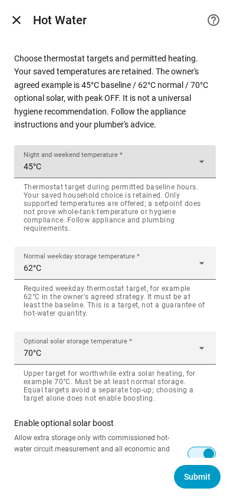

# Find and understand your settings

In Home Assistant, open **Settings → Devices & services → Integrations →
Thermann Controller**, then its **Configure/settings** control. These screens
read your current settings. Opening or closing them does not operate the heater.
Each page saves separately; closing it without submitting leaves it unchanged.
Turn **Automatic heater control** off before changing protected settings. A
rejected change saves nothing and explains why.

| Section | What you will find |
|---|---|
| Hot Water | Night/weekend, normal weekday and optional solar temperatures; peak policy; solar-boost switch; ready times and planning margin |
| Electricity Tariffs | Plan type, retail prices, time zone, tariff clock, verification; two-peak example hours; guided custom periods; expert JSON alternative |
| Solar & Meters | Optional solar/grid/forecast/circuit readings; forecast allowances; grid sign and verification |
| Advanced/System | Equipment estimates, economic margins, cloud-check previews and qualified adaptive checks, data freshness, bridge mappings, notifications, command budgets and supervised commissioning records |

Every field has an explanation directly below it. Examples are starting points
to check, not universal recommendations. Existing household temperatures,
prices, readings, verification records and entity identities survive the upgrade.
Your agreed 45/62/70°C strategy is unchanged. The device's existing native
setting entities retain their original IDs and units; the new units below apply
to these Configure screens.

## Electricity prices and clocks

A kWh is a unit of electricity. A 3 kW element running for an hour uses about
3 kWh. Enter retail **cents per kWh**, not the fixed daily supply charge: 25 means
$0.25/kWh. Saved dollars/kWh are converted for display without rounding away
precision. Percentages work the same way: 25% is stored as 0.25.

**Flat rate** uses one price all day and has no peak restriction periods.
**Off-peak** usually means cheaper hours; **peak** usually means dearer hours
where your heating policy applies; **shoulder** is an intermediate period.
The **feed-in payment** is money you give up when exported solar is used at home.
Network tariffs describe network charges; your retailer's actual contract
determines the retail prices to enter.

**Household time zone** controls local ready times. **Local tariff time** follows
daylight saving in that zone. **Fixed standard time** keeps the zone's standard
offset year-round. For example, a fixed AEST 07:00 period is 08:00 on a Hobart
summer wall clock. Check which clock your contract specifies.

The Aurora-style two-peak plan is a labelled example with editable hours and a
weekend switch. It is not the default contract for every household. For a custom
plan, use **Guided electricity schedule**:

1. The summary shows the active plan and a separate draft table.
2. Choose **Edit a period** and its number, or **Add a period**.
3. Select weekdays, start/end, price category and months. All 12 months means
   year-round. To specify a midday discount or seasonal price, enable a separate
   period price and enter cents/kWh; otherwise the category's saved price applies.
4. **Update draft** returns to the summary. Repeat as needed. Removing a period
   needs confirmation and still changes only this draft.
5. Choose **Save and use this custom schedule**. The existing tariff validator
   checks complete coverage of every minute, weekday and month, without overlaps.
   Only a valid full schedule is stored and selected. It never ticks contract
   verification for you. Closing instead discards the draft.

Home Assistant may show seconds or AM/PM according to your profile. Leave seconds
at 00; this controller uses whole-minute schedules. Use 00:00 for midnight. Equal start and end means all day; an end earlier than
the start crosses midnight. End times are exclusive. Season matching uses the
current tariff-clock date, including overnight tails. Up to 32 periods fit the
existing supported tariff model. Conditional free power, demand/tier charges,
controlled loads and time-varying export prices remain unsupported.

The expert JSON editor remains available; its optional `rate` field still uses
**dollars/kWh**. It does not automatically select Custom. Most users should use
the guided editor and prices form instead.

## Solar, meters and ordinary heating

Leave optional readings empty if equipment is absent. Basic required heating
does not need solar, EMHASS or a dedicated hot-water CT. Without the CT, nominal
tank size and element rating estimate time; cloud mode does not prove the element
is electrically on. Optional solar-only boost supports either a commissioned
dedicated hot-water circuit meter (CT) or the separately configured experimental
CT-free GoodWe grid-meter setup. Turning **Enable optional solar boost** on alone
does not start boosting: automatic control must be enabled and all measurement,
solar surplus, cost, peak-policy and command-safety requirements must pass.
An unavailable previously commissioned meter stays a fault, never measured zero.

Forecasts are predictions, not spare power. The percentage allowance reduces
predicted solar and increases predicted household demand. Old forecasts are
ignored. Map the actual raw heater-circuit entities, not dashboard templates.
Verify grid import/export direction with known loads before marking it checked.

**Never schedule heating during peak** takes priority over surplus solar.
The separate owner Override and native protective behaviour remain independent.
Cloud OFF is a software command, not proof of zero electrical consumption.

## Advanced controls and safe upgrades

Commissioning flags record separately approved tests; they are not shortcuts
to enable a feature. Leave learning and adaptive gates off until qualified.
Longer quiet checks save requests but delay detecting app changes. Exact-prior
checks, confirmation, request limits and original fixed fallback stay intact.

No storage-schema migration is required for this presentation update. The same
options are saved under the same keys, and unrelated fields and Restore/Undo
snapshots are preserved. Clearing or changing a power mapping still clears its
existing circuit/learning qualification. No bridge update or credential changes
are part of this UI work. Installation needs separate owner approval.

## Frontend verification

The configuration was exercised in official Home Assistant **2026.10.4 and
2026.11.1**, with a real Chromium browser at **1280×960** and **390×844**. All
12 form pages were checked at both widths for rendered labels, inline help and
horizontal overflow. Each settings/mapping page was also submitted unchanged
through the actual frontend and compared with its saved options. Guided draft
editing, invalid schedules, cancellation, clearing optional text/mappings,
active-control locks and entity identities have real HA backend regression tests.

Screenshots were manually inspected for readable labels, wrapping, units,
scrolling, tariff summaries and beginner instructions. This caught and corrected
misnumbered Markdown periods and overly long headings. Empty commissioning text
fields are optional rather than being presented as mandatory. Home Assistant's
native picker appearance varies slightly between these two supported versions.
Long forms scroll vertically; the submit button remains at the bottom.

The screenshots below are unedited captures from an isolated, synthetic
installation, not the owner's live system. They show example household values,
not verified prices or permission to enable any feature. Capture source:
`8d9eff2bdbe1a24775649562de11ed74a0e20256`, HA 2026.11.1,
[real-frontend CI run](https://github.com/MuntedDaze/ha-thermowatt-heater/actions/runs/43729092473).
The complete desktop/phone screenshots for both versions are in that run's
`configuration-ui-*` artifacts. Final-head CI is linked in
[merged PR #38](https://github.com/MuntedDaze/ha-thermowatt-heater/pull/38).

| See the actual screens | What to notice |
|---|---|
| [Hot Water on a phone](screenshots/hot_water-390.png) | Supported targets and explanations directly below the controls |
| [Retail prices on desktop](screenshots/prices-bottom-1280.png) | Saved precision retained while displaying cents/kWh |
| [Solar settings on a phone](screenshots/solar-390.png) | Optional forecasts and a visible percentage allowance |
| [Seasonal period editor on a phone](screenshots/period-bottom-390.png) | Month chips, optional price override and Update draft |
| [Advanced settings on a phone](screenshots/commissioning-bottom-390.png) | Budgets, confirmation timeout and an optional notification address |

These checks cover the standard English frontend/light theme on the two listed
HA versions. They do not constitute a usability study with novice participants,
a check of every theme/browser, physical commissioning or installation approval.
No live Home Assistant or vendor service was contacted.

Engineering references: [HA form descriptions and menus](https://contributors.home-assistant.io/core/integrations/flow-steps/),
[HA translation conventions](https://contributors.home-assistant.io/core/integrations/translations/),
[supported selectors](https://www.home-assistant.io/docs/blueprint/selectors/).
