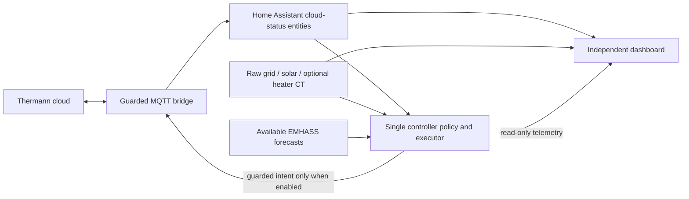

# Four-state controller candidate

Historical PR #34 checkpoint. Current integrated development, including common
household configuration and disabled-by-default adaptive/learning code, is
described in the [current guide](../final-integration/COMPLETION_MATRIX.md).
The following records the unchanged PR #34 candidate, not fresh setup defaults.

This guide describes bridge **1.3.14** and controller **0.10.0**, under review in
[draft PR #34](https://github.com/MuntedDaze/ha-thermowatt-heater/pull/34). It does
not authorise an installation, live test, automatic-control enable or heater
command. The previous tested recovery point is PR #33 at `cf97d5e`.

## Supported scope

The integration targets the supported Thermann Control / MyThermowatt interface,
with status experience from a Thermann Smart Electric 315 L / 3 kW installation.
It is unofficial and cloud-dependent. Other appliances, accounts, modes and
setpoints need independent compatibility checks. Configurable volume/power
changes planning arithmetic; they do not qualify a new heater model.

The tested distribution is the Home Assistant add-on on amd64/aarch64 plus a
custom integration, MQTT broker and MQTT integration. The component is exercised
in HA Core 2026.10.4 and 2026.11.1; Supervisor schemas in 2026.10.5/2026.11.0 and
unit/static checks on Python 3.12/3.13/3.14. This is a tested matrix, not a claim
that other releases are incompatible or that physical hardware is certified.

Only one heater/controller entry and one bridge per cloud account are supported.
The legacy unique-ID string containing `315l` identifies the existing config
entry; it is not a guessed serial, a verified volume or a second device profile.
Select the actual bridge entities during setup. Fresh setup preselects none.

## How the parts cooperate

The bridge owns authentication, fixed clock-aligned polling, persisted lockouts,
request accounting, exact-prior command guards and confirmation. The controller
evaluates local inputs about once a minute without polling the heater itself.
It persists each intent before publishing it, then supervises observed readback.
Neither forecasting nor dashboards send heater commands.

## One coordinated strategy

| Default physical state | Purpose |
|---|---|
| OFF | Park routine heating at peak, including the two-minute command lead |
| BASELINE: Manual 45°C | Permitted nights and weekends; no compulsory weekend 62°C |
| NORMAL_STORAGE: Manual 62°C | Required weekday storage before the afternoon peak |
| SOLAR_BOOST: Manual 70°C | Optional extra useful heat when measured solar and economics qualify |

These are thermostat requests. A 62°C setting does not mean the bottom probe is
62°C or that the element energises immediately. The approximate native 8°C
hysteresis and recent actual element draw matter. The controller uses fresh
cloud temperature, nominal conservative heat time, current verified solar and
forecast opportunity costs to select a practical low-cost window. The default
completion target is 30 minutes before peak; required heating can continue past
that soft target up to the hard peak lead. Late/cold starts can miss the target.

Strong qualified solar can select 70°C directly. A later opportunity can raise
62°C to 70°C. Optional heat must cover the element, remain measured-qualified,
fit before the permitted boundary and exceed foregone feed-in earnings, expected
unused heat/standby allowance and a minimum benefit for extra switching. Existing
10-minute qualification, five-minute measured withdrawal, 15-minute spacing,
request reserves and command caps limit churn. A sunny forecast alone cannot
authorise optional heating or preserve it during sustained measured import.

At 315 L, a uniform 62-to-70°C rise theoretically needs about 2.93 kWh. This is
physics, not a measurement of available hot water. The useful-demand fraction
and standby allowance are explicit conservative assumptions, not learned facts.
See [the replay comparisons](SIMULATIONS.md), including forecast errors and
equal-terminal-energy accounting. There is no annual savings claim.

## Independent user choices

| Peak policy | Optional boost | Routine behaviour |
|---|---|---|
| Never schedule heating during peak | On | Required off-peak normal storage; qualified boost only in permitted off-peak windows |
| Never schedule heating during peak | Off | Baseline and required normal storage, no discretionary 70°C |
| Verified solar-only heating | On | Optional peak heat only with fresh verified circuit/grid and every economic/safety guard |
| Verified solar-only heating | Off | No optional 70°C; measured-qualified peak opportunity may use the normal target |

The **Never** choice takes priority over solar export and forecasts. It requests
OFF ahead of peak and never intentionally starts or continues routine heating
during peak. If OFF is blocked or unconfirmed, `peak_lockout_unverified` reports
the intended lockout as unverified. It never promises zero watts. Authentication,
owner-change holds, quotas and uncertain-command rules are not bypassed.

An explicit owner **12hr Override** remains Manual 70°C and takes precedence
over routine peak/boost choices for its bounded duration. An owner app change
also retains control, including during peak. Native protective cycles remain
independent in every mode; the software does not schedule or suppress them.
Users must verify their appliance, installation and temperature strategy with
the relevant qualified professional; this controller is not a hygiene monitor.

## CT-measured and CT-free operation

Without a dedicated heater power mapping, the installation is `ct_free`.
Baseline and required off-peak storage use cloud mode/setpoint/temperature,
verified tariffs and available forecasts; nominal element power and volume are
planning references only. Physical element status remains unknown. Optional
solar boost is unavailable and peak lockout is the default. Aggregate house-load
inference and cloud status bits are never physical verification or optional-heat
authority.

With a commissioned raw circuit meter, measured W/kW and optional cumulative
Wh/kWh improve diagnostics, heat-time estimates and solar qualification. A mapped
meter that expires or fails becomes `meter_fault`, not zero or silent CT-free
operation. Optional heat is withdrawn conservatively, required heating retains
its cloud/tariff fallback, and persistent faults are notified. Ordinary OFF/ON
thresholds and plausibility limits scale with configured nominal power.

The raw sensor must actually republish at steady zero within 120 seconds.
`last_reported` is HA receipt time, not device acquisition proof. A device that
only sends changed values is not qualified by mapping its entity: verify its
report cadence/transport or leave optional heating unavailable. Do not fabricate
freshness with a template or a clock. The raw signed watts are kept for diagnosis;
negative, implausible, restored, stale or unsupported-unit readings do not qualify.

## What is live code, advisory or still unverified

| Capability | Candidate status |
|---|---|
| Fixed 30-minute default bridge polling and existing guards | Implemented; configuration can change the supported fixed interval |
| Four-state policy, peak/boost choices, CT-free required heating | Implemented and offline tested; new transitions physically unqualified |
| Raw CT integration and covered energy integration | Implemented; needs real independent sensor commissioning |
| Conditional heating-completion range | Diagnostic; unknown without reliable active circuit evidence; not a promise |
| Target/model-specific history | Compact measured session store; old untagged data retained but excluded from calibration |
| Learned heat rate | Diagnostic only, after at least 10 clean independent sessions on at least three days; no control authority |
| Adaptive polling | Opt-in shadow comparison only; no additional cloud requests or changed actual schedule |
| Stored tank state | Legacy 315 L/3 kW estimate remains diagnostic; not a usable-water reserve or calibrated hygiene value |
| Dashboard/reporting | Separate Fable draft PR #32; neither branch depends on the other |

Continue with [installation](INSTALLATION.md), [upgrade/rollback](UPGRADE.md),
[telemetry](TELEMETRY_INTERFACE.md) and the
[household example](HOUSEHOLD_EXAMPLE.md). Historical guides under
`shadow_controller/` and `docs/history/` describe their named versions.
